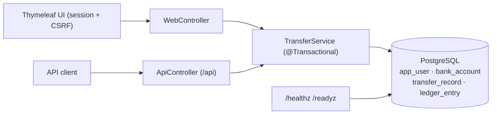

# Architecture

## Money model
- All money is `long` **minor units** (cents) in one declared currency (USD). No floating point anywhere.
- Every transfer writes exactly two immutable `ledger_entry` rows: `-amount` (DEBIT, source) and `+amount` (CREDIT, destination). They always sum to zero — no money is created or destroyed.
- `bank_account.balance_minor` is a cached balance updated in the same transaction; `TransferService.reconciles(accountId)` proves cache == `SUM(ledger_entry)` and the integration tests assert it after transfers and after the concurrency run.

## Correctness mechanisms
1. **Database transaction** — balance updates, transfer record, and both ledger rows commit or roll back together.
2. **Ordered pessimistic locking** — both accounts are locked with `SELECT … FOR UPDATE` in ascending ID order, so concurrent transfers cannot interleave a lost update and cannot deadlock by ordering.
3. **Idempotency** — `transfer_record.idempotency_key` has a DB unique constraint. A retry with the same key + same payload hash returns the original transfer; same key + different payload → HTTP 409. A concurrent duplicate-key insert surfaces as 409 with a "retry the identical request" message, at which point the retry reads the original.
4. **Validation & authorization** — positive amounts, distinct accounts, currency match, sufficient funds (422), and source-account ownership (403) are all checked inside the transaction.

## Components
Spring Boot 3.3 (Web, Security, Data JPA, Thymeleaf), Flyway migrations, PostgreSQL, springdoc OpenAPI at `/swagger-ui.html`, Actuator health plus explicit `/healthz` (liveness, no DB) and `/readyz` (readiness, checks a DB connection).
